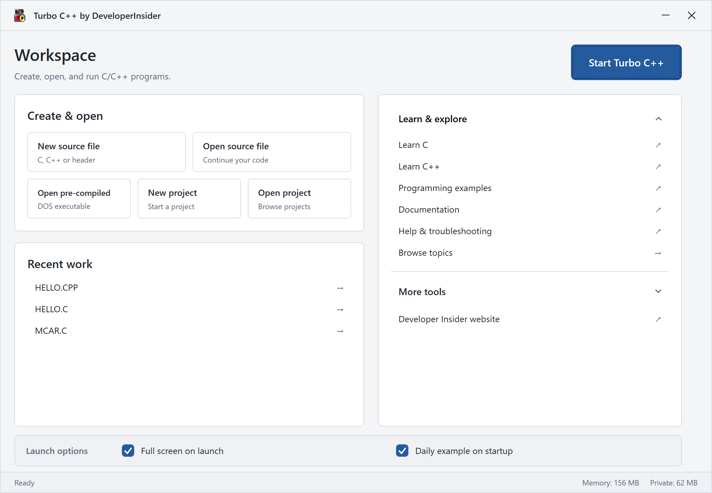
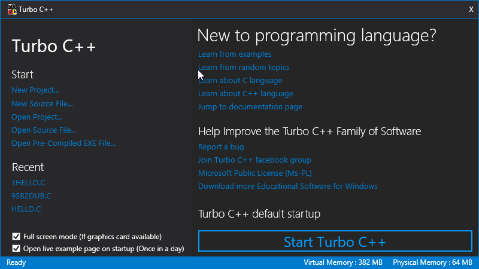
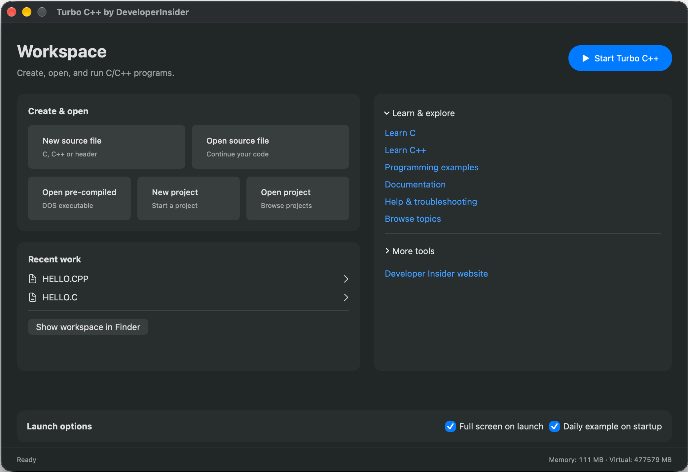

# Turbo C++ for Windows and macOS

Run the classic Borland Turbo C/C++ IDE with native Windows and macOS launchers and bundled DOSBox. Compile and run legacy C/C++ programs.

## Download

[Official download page](https://developerinsider.co/turbocpp) · [GitHub Releases](https://github.com/vineetchoudhary/TurboCPP/releases)

| Platform | Launcher Version | Package Download Link |
| --- | --- | --- |
| Windows 11 x64 | 4.0 | [TurboCPP-Windows-x64-Setup.exe](https://github.com/vineetchoudhary/TurboCPP/releases/download/v4.0/TurboCPP-Windows-x64-Setup.exe) |
| macOS 14+, Apple silicon | 4.0 | [TurboCPP-macOS-arm64.dmg](https://github.com/vineetchoudhary/TurboCPP/releases/download/v4.0/TurboCPP-macOS-arm64.dmg) |
| macOS 12+, Intel | 4.0 | [TurboCPP-macOS-x86_64.dmg](https://github.com/vineetchoudhary/TurboCPP/releases/download/v4.0/TurboCPP-macOS-x86_64.dmg) |
| Windows 10 / 8.1 / 8 | 3.2 | [Legacy Turbo.C.3.2.zip](https://github.com/vineetchoudhary/TurboCPP/releases/download/v3.2/Turbo.C.3.2.zip) |
| Windows 7 | 3.2 | [Legacy Turbo.C.3.2.Net4.5.zip](https://github.com/vineetchoudhary/TurboCPP/releases/download/v3.2/Turbo.C.3.2.Net4.5.zip), requires .NET Framework 4.5 |

**Version 4.0 requires Windows 11 x64 or a supported Mac.** The Windows installer bundles .NET and DOSBox and Mac packages bundle DOSBox and need no .NET or Homebrew.

## Features

- Create and open C/C++ source files, headers, and projects.
- Reopen recent work and run precompiled DOS executables.
- Use fullscreen or windowed mode, lessons, and programming examples.
- Open website examples through `turbocpp:` links and files through **Open With**.
- Receive update prompts, local compilation stays available offline.

## Screenshots

### Windows 11

### Windows 10 or older

### macOS

## Help

- [Common issues](https://developerinsider.co/solution-of-common-turbo-c-issues/) 
- [IDE shortcuts](https://developerinsider.co/turbo-c-shortcuts/) 
- [C/C++ tutorials](https://developerinsider.co/c-and-cpp-insider/) 
- [Report a problem](https://github.com/vineetchoudhary/TurboCPP/issues)

Include your app version, OS, processor, and steps to reproduce when reporting a problem.

## License

Original project material uses [Apache 2.0](LICENSE). Borland compiler/IDE and DOSBox components retain their own licenses. See [NOTICE](NOTICE).
